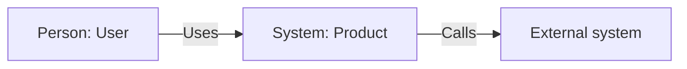
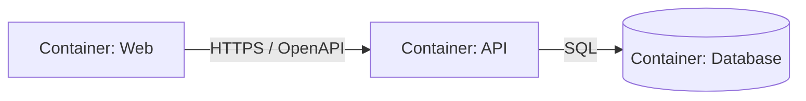

# C4: nome do sistema

## Metadados

- Verified revision:
- Owners:
- Related ADRs:
- Catalog entities:

## Contexto (L1)

Pessoas e sistemas externos, propósito, trust boundaries e principais fluxos.

## Containers (L2)

Apps, serviços, stores, protocolos, deployment units e ownership.

## Components (L3)

Crie apenas para containers onde boundaries/componentes agreguem decisão. Referencie source paths e contratos.

## Código (L4)

Evite manter diagrama manual de detalhes que o código ou ferramenta consegue gerar. Use somente quando esclarece estrutura crítica.

## Regras de sincronização

Mudança de boundary, protocolo, store ou dependência externa atualiza C4, catálogo/PROJECT_MAP e ADR na mesma Change Case.
